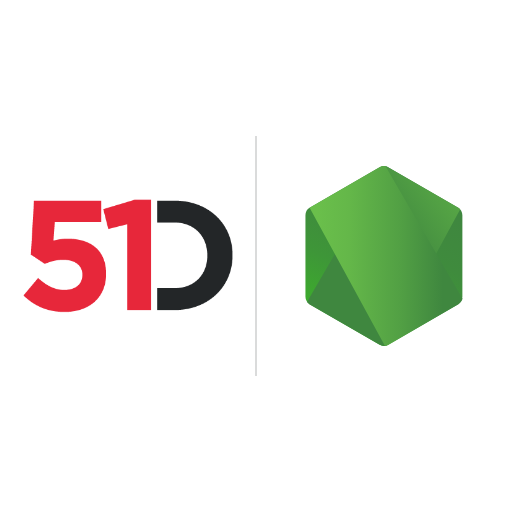

# 51Degrees Device Detection and IP Intelligence for Node.js



**Node.js packages for Device Detection, IP Intelligence and Location**

Our User-Agent parser for Node.js supports Device Detection, browser detection, mobile detection, and crawler detection on-premise or in the cloud. IP Intelligence adds IP geolocation, including IP to country data.

It reads User-Agent and User-Agent Client Hints, HTTP request headers that carry browser and device information. For cloud bot detection, Human Confidence reports confidence that a person is viewing the page.

## Install

Each product is a separate npm package. For Device Detection and IP Intelligence, cloud or on-premise:

```
npm install fiftyone.devicedetection
npm install fiftyone.ipintelligence
```

The product guides below list the cloud-only and on-premise-only packages. To work on the source, see [Getting the code](#getting-the-code).

Try the [User-Agent tester](https://51degrees.com/developers/user-agent-tester?utm_source=github&utm_medium=readme&utm_campaign=51degrees-node&utm_content=readme.md&utm_term=install) and [IP tester](https://51degrees.com/developers/ip-tester?utm_source=github&utm_medium=readme&utm_campaign=51degrees-node&utm_content=readme.md&utm_term=install). For cloud use, [create a Resource Key](https://configure.51degrees.com/?utm_source=github&utm_medium=readme&utm_campaign=51degrees-node&utm_content=readme.md&utm_term=install).

Created from `pipeline-node`, `device-detection-node`, and `location-node`, this repository continues their work.

The folder table and product guides below show where to find usage examples and how to build and test the source.

| Product | Read first | Documentation |
| --- | --- | --- |
| Pipeline API | [pipeline/readme.md](pipeline/readme.md) | [Guide](https://51degrees.com/documentation/_pipeline_api__concepts__pipeline_basics.html?utm_source=github&utm_medium=readme&utm_campaign=51degrees-node&utm_content=readme.md&utm_term=pipeline-guide) and [Node.js API](https://51degrees.com/documentation/apis/pipeline-node/annotated.html?utm_source=github&utm_medium=readme&utm_campaign=51degrees-node&utm_content=readme.md&utm_term=pipeline-node-js) |
| Device Detection | [device-detection/readme.md](device-detection/readme.md) | [Guide](https://51degrees.com/documentation/_device_detection__quickstart.html?utm_source=github&utm_medium=readme&utm_campaign=51degrees-node&utm_content=readme.md&utm_term=device-detection-guide) and [Node.js API](https://51degrees.com/documentation/apis/device-detection-node/annotated.html?utm_source=github&utm_medium=readme&utm_campaign=51degrees-node&utm_content=readme.md&utm_term=device-detection-node-js) |
| IP Intelligence | [ip-intelligence/readme.md](ip-intelligence/readme.md) | [Guide](https://51degrees.com/documentation/_ip_intelligence__quickstart.html?utm_source=github&utm_medium=readme&utm_campaign=51degrees-node&utm_content=readme.md&utm_term=ip-intelligence-guide) and [Node.js API](https://51degrees.com/documentation/apis/ip-intelligence-node/annotated.html?utm_source=github&utm_medium=readme&utm_campaign=51degrees-node&utm_content=readme.md&utm_term=ip-intelligence-node-js) |
| Location | [location/README.md](location/README.md) | [Guide](https://51degrees.com/documentation/_reverse_geocoding__quickstart.html?utm_source=github&utm_medium=readme&utm_campaign=51degrees-node&utm_content=readme.md&utm_term=location-guide) and [Node.js API](https://51degrees.com/documentation/apis/location-node/annotated.html?utm_source=github&utm_medium=readme&utm_campaign=51degrees-node&utm_content=readme.md&utm_term=location-node-js) |

## What is where

| Path | Contents |
| --- | --- |
| `pipeline` | The Pipeline API packages, `fiftyone.pipeline.*` |
| `device-detection` | The Device Detection packages, `fiftyone.devicedetection*` |
| `ip-intelligence` | The IP Intelligence packages, `fiftyone.ipintelligence*` |
| `location` | The `fiftyone.geolocation` package |
| `cxx` | Submodule of [51degrees-cxx](https://github.com/51Degrees/51degrees-cxx), with the C and C++ code |
| `cxx/data` | The [data](https://github.com/51Degrees/data) submodule of `cxx`, whose `device-detection` and `ip-intelligence` folders hold the data files the tests and examples use |
| `ci` | The scripts the shared 51Degrees CI workflows call |

## Getting the code

```
git clone --recurse-submodules https://github.com/51Degrees/51degrees-node.git
cd 51degrees-node
npm install
```

`npm install` links every package to the others in this repository through
npm workspaces, so a change to one package is seen by the rest straight away.

The data files themselves are not stored in a repository. The `cxx/data`
submodule holds a `.link` file for each free one, where the file goes, and two
scripts that download them. From the repository root, run

```
sh cxx/data/get-data-files.sh
```

or, in PowerShell,

```
./cxx/data/get-data-files.ps1
```

They download the Device Detection Lite file, the 20,000 User-Agents and
evidence records, and the IP Intelligence Lite and ASN files. A file that is
already there is kept, unless `-u` (`-Update`) asks for a newer one or `-f`
(`-Force`) downloads it again. An example whose file is missing runs the script
for that file itself.

An existing clone fetches the data submodule with
`git submodule update --init --recursive`. Nothing here reads the older
`cxx/device-detection-data` and `cxx/ip-intelligence-data` folders. Once cxx no
longer includes them, delete them from an existing clone, because Git leaves a
removed submodule's folder on disk.

## Building the native modules

The on-premise packages need a native module, built with
[node-gyp](https://github.com/nodejs/node-gyp). The configuration is stored as
`binding.51d` so that `npm install` does not start a build for cloud users.
In `device-detection/fiftyone.devicedetection.onpremise` or
`ip-intelligence/fiftyone.ipintelligence.onpremise`, run:

```
cp binding.51d binding.gyp
node-gyp rebuild
```

Then copy `build/Release/<module>.node` to
`build/<module>-<platform>-<arch>-<node major version>.node`, for example
`build/FiftyOneDeviceDetectionHashV4-darwin-arm64-24.node`.

## Tests

From the repository root:

```
npm run unit-test
npm run integration-test
npm run lint
npm run tsc
```

The tests that use the cloud need a Resource Key, which is read from the
`_51DEGREES_RESOURCE_KEY` environment variable. See each folder's readme for
the keys and data files its tests use.

## Regenerating the SWIG wrappers

The wrappers are generated and must not be edited by hand. Use the
`node-24-holder-this` branch of the
[51Degrees fork of SWIG](https://github.com/51Degrees/swig), and run:

```
cd device-detection/fiftyone.devicedetection.onpremise
swig -c++ -javascript -node hash_node.i
cd ../../ip-intelligence/fiftyone.ipintelligence.onpremise
swig -c++ -javascript -node ipi_node.i
```

## History

| Earlier repository | What it held |
| --- | --- |
| [pipeline-node](https://github.com/51Degrees/pipeline-node) | The Pipeline API |
| [device-detection-node](https://github.com/51Degrees/device-detection-node) | Device Detection |
| [location-node](https://github.com/51Degrees/location-node) | Location |


The earlier repositories were brought in with
`git subtree add`, without `--squash`, so commit SHAs match the originals. Use
`git log --follow` to trace a file back through the import.

## License

[European Union Public Licence v1.2](LICENSE)

## Find out more

- [Device Detection](https://51degrees.com/device-detection?utm_source=github&utm_medium=readme&utm_campaign=51degrees-node&utm_content=readme.md&utm_term=find-out-more)
- [IP Intelligence](https://51degrees.com/ip-intelligence?utm_source=github&utm_medium=readme&utm_campaign=51degrees-node&utm_content=readme.md&utm_term=find-out-more)
- [Bots and humans](https://51degrees.com/bots-and-humans?utm_source=github&utm_medium=readme&utm_campaign=51degrees-node&utm_content=readme.md&utm_term=find-out-more)
- [Documentation](https://51degrees.com/documentation/index.html?utm_source=github&utm_medium=readme&utm_campaign=51degrees-node&utm_content=readme.md&utm_term=find-out-more)
- https://github.com/51Degrees/51degrees-cxx
